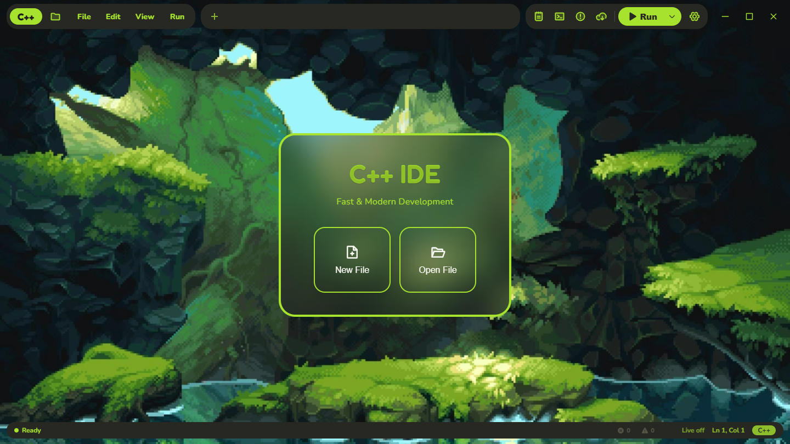
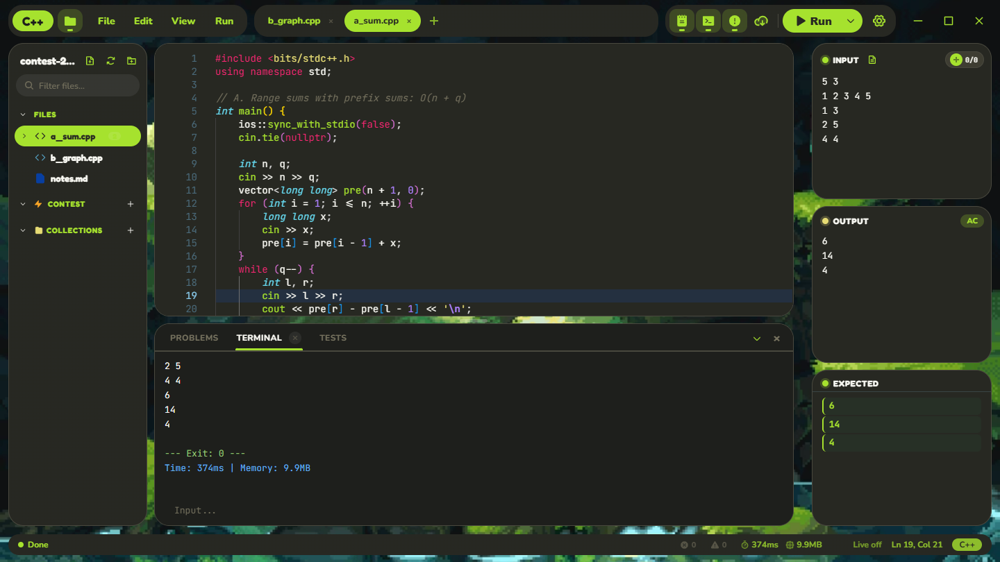
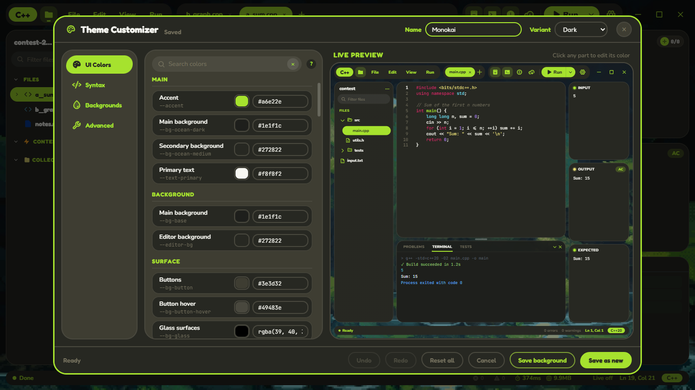
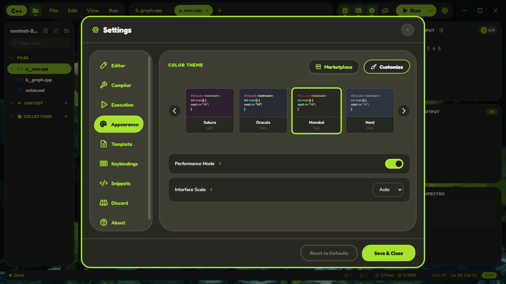

<div align="center">
  <br />
  
  <br />

  # 🐟 Sameko Dev C++ ⚓
  
  **The cutest & fastest C++ IDE for your coding adventures! (≧◡≦) ♡**

  <p>
    <a href="https://sameko.dev/" target="_blank" rel="noopener noreferrer">
      
    </a>
    <a href="https://github.com/QuangquyNguyenvo/Sameko-Dev-CPP/blob/main/LICENSE">
      
    </a>
    <a href="https://github.com/QuangquyNguyenvo/Sameko-Dev-CPP">
      
    </a>
  </p>
</div>

<br />

<div align="center">
  ★ 。＼｜／。★
  <br/>
  <b>Welcome to the deep blue sea of coding! 🌊</b>
  <br/>
  ★ 。／｜＼。★
</div>

<br />

<div align="center">
  
</div>

<br />

<div align="center">
  <p>
    <a href="#-features">Features</a> •
    <a href="#-screenshots">Screenshots</a> •
    <a href="#-download">Download</a> •
    <a href="#-development">Development</a> •
    <a href="#-shortcuts">Shortcuts</a>
  </p>
</div>

<br />

## 🎯 About

<table>
  <tr>
    <td width="70%">
      <p><b>Sameko Dev C++</b> is a free, open-source C++ IDE for Windows and Linux, built for competitive programming and learning. The Windows build includes GCC 16, clangd and GDB. On Linux, Sameko uses the tools installed on your system.</p>
      <blockquote>💡 Think of it as a modern Dev-C++ alternative: simple interface, fast compilation, works out of the box.</blockquote>
      <p>🐟 <b>Unofficial fan project</b>, not affiliated with Sameko Saba. <a href="#-the-story-behind-it">Why the name?</a></p>
    </td>
    <td width="30%" align="center">
      
    </td>
  </tr>
</table>

<br />

## ✨ Features

### Build and run

- 🚀 GCC 16 comes bundled on Windows. On Linux, Sameko uses your system's `g++`.
- ⚡ Press `F11` to build and run. An unchanged file can run again without recompiling.
- 🔗 Include a custom header to link its sibling `.cpp` file when multi-file mode is enabled.
- 🧠 Get code completion and live diagnostics with clangd. Choose a C++ standard and add compiler flags in Settings.

### Practice and debug

- ✅ Compare Input, Output and Expected results with AC, WA and TLE verdicts. Load large inputs from a `.txt` file.
- 🏆 Fetch problems and test cases with Competitive Companion. Run all tests in parallel or inspect them one at a time.
- 🗂️ Organize problems into contests and collections, with statuses, notes and saved approaches.
- 🐞 Debug with GDB using breakpoints, conditional breakpoints, watches and STL-aware variable trees. Auto dry run steps through code while you watch variables change.

### Edit and customize

- 📑 Work across tabs and split editor panes. Rename tabs, drag files into the window and create C++, C, input, output, text or Markdown files from the tab bar.
- 📝 Preview Markdown beside the editor as you type. Toggle the preview with `Ctrl+Shift+V`.
- 🧹 Format C and C++ with AStyle. Choose from 13 styles and optionally format on `Ctrl+S`.
- ✂️ Customize snippets and C or C++ templates. Import templates and snippets from files.
- 💾 Use auto-save, session restore and local history checkpoints to return to your work. Sameko also notices changes made outside the editor.
- 🎨 Choose from six built-in themes or create your own with the Theme Customizer. Add an image or video background and share your theme.
- 🔎 Search settings and shortcuts from the Settings dialog. Keybindings can be customized there too.

Explore the [user guide](https://sameko.dev/wiki.html) for more features and instructions.

<br />

## 📸 Screenshots

<div align="center">
  
  <br /><br />
  
  
  <br />
  
  
</div>

<br />

## 🆕 What's New in v1.3.2

- **Markdown preview.** Read a rendered preview beside your editor while writing notes and solutions.
- **Format your way.** Pick an AStyle format and turn on Format on Save for C and C++ files.
- **More flexible files.** Create different file types from the tab bar, rename a tab or drop files into the window to open them.
- **Find settings faster.** Search settings and keyboard shortcuts in one place.
- **Import templates and snippets.** Bring them in from files, thanks to contributions from [@aguajardoc](https://github.com/aguajardoc).
- **A smoother interface.** Settings and dialogs respond faster, and background video pauses when you switch to another window.
- **Fixes throughout the editor.** This release improves formatting, breakpoints, C++ highlighting, file renaming and UTF-16 support.

See [CHANGELOG.md](CHANGELOG.md) for the full list and [the release notes](https://github.com/QuangquyNguyenvo/Sameko-Dev-CPP/releases/tag/v1.3.2) for screenshots.

### Multi-file project note

If your project is split across multiple `.cpp` files and you see linker errors like `undefined reference`, open:

- `Settings > Compiler > Single-file Compile Mode`

Then turn it **OFF** and build again.

## 📥 Download

<div align="center">

<a href="https://sameko.dev/" target="_blank" rel="noopener noreferrer">
  
</a>
<a href="https://github.com/QuangquyNguyenvo/Sameko-Dev-CPP/releases/latest" target="_blank" rel="noopener noreferrer">
  
</a>

</div>

<br />

### 🪟 Windows *(Compiler Bundled)*

> 💡 **Zero setup required.** MinGW-w64 (GCC 16.1.0) is pre-packaged. Download and code!

| Package | Format | Description | Recommendation |
| :--- | :---: | :--- | :--- |
| **Installer** | `sameko-dev-cpp-setup-<version>.exe` | Step-by-step installer with Start Menu shortcuts & auto-update | **⭐ Recommended for most users** |
| **Portable** | `.zip` | Standalone archive. Extract anywhere (including USB drives) and run | Ideal for school / restricted PCs |

> 🛡️ **Windows SmartScreen** may warn that the app is from an unknown publisher, because the builds are not code-signed yet. Click **More info → Run anyway**. You can check the 1.3.2 installer's [VirusTotal scan](https://www.virustotal.com/gui/file/d637ba43334f6bd5995686485d7b4a83469a9ced145483bd1e8322135c95723a).

<br />

### 🐧 Linux Installation Guide

The v1.3.2 release provides an AppImage for 64-bit Linux. Sameko uses the compiler and tools installed on your system.

#### 📌 Step 1: Install the tools

Install `g++` to compile programs and `gdb` to debug them. Install `clangd` for code suggestions and live diagnostics, and `astyle` for code formatting. Open a terminal and run the command for your distribution:

```bash
# Debian / Ubuntu / Linux Mint / Pop!_OS
sudo apt update && sudo apt install -y g++ gdb clangd astyle

# Fedora / RHEL
sudo dnf install -y gcc-c++ gdb clang-tools-extra astyle

# Arch Linux / Manjaro
sudo pacman -S --noconfirm gcc gdb clang astyle
```

---

#### 📌 Step 2: Download Sameko

Download `sameko-dev-cpp-1.3.2-linux-x86_64.AppImage` from [GitHub Releases](https://github.com/QuangquyNguyenvo/Sameko-Dev-CPP/releases/tag/v1.3.2) or visit [sameko.dev](https://sameko.dev/).

---

#### 📌 Step 3: Make it executable and run it

Open a terminal in the folder where you downloaded the file, then run:

```bash
chmod +x sameko-dev-cpp-1.3.2-linux-x86_64.AppImage
./sameko-dev-cpp-1.3.2-linux-x86_64.AppImage
```

You can keep the AppImage wherever you like and run it again from that folder. To build `.deb` or `.tar.gz` packages yourself, see [Building](#building).

---

<details>
<summary><b>🔍 Linux Troubleshooting Tips (FUSE 2 & Chrome Sandbox)</b></summary>

<br />

- **AppImage fails to open**: Ubuntu 22.04+ may require FUSE 2:
  ```bash
  sudo apt install libfuse2
  ```
  *(Or run with `./sameko-dev-cpp-*.AppImage --appimage-extract-and-run`)*

- **Chrome Sandbox permission error**: If running unpacked `.tar.gz` on Ubuntu 24.04+:
  ```bash
  sudo chown root:root chrome-sandbox && sudo chmod 4755 chrome-sandbox
  ```
  *(The `.deb` installer configures sandbox permissions automatically).*

- **AppImage closes right away with a sandbox error** (`The SUID sandbox helper binary was found, but is not configured correctly`): Ubuntu 24.04+ can block the sandbox for apps that are not installed. A `.deb` built from source sets it up during installation. Another option is to start the AppImage with:
  ```bash
  ./sameko-dev-cpp-*.AppImage --no-sandbox
  ```

- **No IntelliSense or Format Code does nothing**: install `clangd` and `astyle` (Step 1), then restart Sameko.

</details>

<br />

## 🛠️ Development

### Prerequisites
- Node.js v18+
- npm or yarn
- On Linux: `g++` and `gdb` (see [Linux](#linux) above)

### Setup

```bash
# Clone the repository
git clone https://github.com/QuangquyNguyenvo/Sameko-Dev-CPP.git
cd Sameko-Dev-CPP

# Install dependencies
npm install

# Run in development mode
npm start
```

### Building

```bash
npm run build        # the three release artifacts: Windows installer + portable .zip + Linux AppImage
npm run build:win    # Windows only
npm run build:linux  # AppImage + .deb + .tar.gz  (run this on Linux or WSL)
npm run build:all    # everything, in one pass
```

Everything lands in `samekodevcpp/`. A full `npm run build` produces:

| Artifact | Notes |
| :--- | :--- |
| `sameko-dev-cpp-setup-<version>.exe` | Windows installer (NSIS); the in-app updater uses this one too |
| `sameko-dev-cpp-<version>-portable.zip` | Windows portable folder, zipped |
| `sameko-dev-cpp-<version>-linux-x86_64.AppImage` | Linux, runs on any distribution |
| `latest.yml` + `.blockmap` | Update metadata the in-app updater reads |

> **How the AppImage gets built on Windows.** Packing an AppImage requires creating symlinks, which
> Windows only allows from an elevated terminal or with Developer Mode on; otherwise electron-builder
> stops at `A required privilege is not held by the client`. `scripts/build-appimage.js` checks for
> that permission up front and, when it is missing, runs the same build **through WSL** - which has
> no such restriction and can build in place from `/mnt/<drive>`. So `npm run build` produces all
> three artifacts on a plain terminal as long as WSL is installed; if it is not, the script prints
> every way to fix it. The Windows targets are built first either way, so they survive a Linux-side
> failure.
>
> `.deb` additionally needs `fpm`, which has no Windows build - run `npm run build:linux` inside WSL
> or on a real Linux machine for the `.deb` and `.tar.gz`.

### Housekeeping

```bash
npm run clean        # wipe settings/history/snippets (the app's user-data folder)
npm run clean:dist   # wipe samekodevcpp/
npm run rebuild      # clean:dist, then a full build
```

<br />

## ⌨️ Shortcuts

| Key                | Action               |
| :----------------- | :------------------- |
| `F9`               | Compile              |
| `F10`              | Run                  |
| `F11`              | Compile & Run        |
| `Ctrl + N`         | New file             |
| `Ctrl + O`         | Open file            |
| `Ctrl + S`         | Save file            |
| `Ctrl + Shift + S` | Save As              |
| `Ctrl + J`         | Toggle Panel         |
| `Ctrl + \`         | Split Editor         |
| `Ctrl + Shift + A` | Auto Format (AStyle) |
| `Ctrl + Shift + V` | Toggle Markdown preview |
| `Ctrl + Alt + S`   | Toggle Auto-Save     |
| `Ctrl + Shift + P` | Command Palette      |

### While debugging

Click the left gutter to set a breakpoint, then press `F5`. `F10` and `F11` switch to stepping for
as long as the session is live, and go back to Run / Compile & Run once it ends.

| Key               | Action                                        |
| :---------------- | :-------------------------------------------- |
| `F5`              | Start debugging · Continue                    |
| `F10`             | Step over                                     |
| `F11`             | Step into                                     |
| `Shift + F11`     | Step out                                      |
| `Shift + F5`      | Stop debugging                                |
| `Esc`             | Stop an Auto dry run · leave the step history |
| `Alt` + gutter    | Conditional breakpoint                        |
| `Ctrl` + gutter   | Enable / disable a breakpoint                 |
| Right-click a line | Run to Cursor                                |

<br />

## 🤝 Contributing

**💖 Contributors**

- **Yunchan** (Special thanks for designing the logo!)
- **[KingShiba3766](https://github.com/daonghiemminh-collab)** (Donated the `sameko.dev` domain)
- **[aiko-chan-ai](https://github.com/aiko-chan-ai)** (Fixed G++ spawn issue on some machines)
- **[aguajardoc](https://github.com/aguajardoc)** (Added template and snippet imports and fixed the Linux dock icon)
- **[baodao211](https://github.com/baodao211)** (Contributed the cursor trail and Scroll Beyond Last Line)
- **[MerlyStella](https://github.com/MerlyStella)** (Tested everything, twice. The app is better because of it :D)

**📝 Want to contribute?**

Contributions are welcome! Please read [CONTRIBUTING.md](CONTRIBUTING.md) before submitting a PR.

<br />

## 🐟 The story behind it

I like making my coding space feel like mine: themes, wallpapers, characters I like. Sameko Saba is one of them.

Classic Dev-C++ can barely be customized. VS Code can, but every time I changed computers (at school, for example) I had to set everything up again: the compiler, extensions, settings, theme. So I made my own IDE, one that comes with its compiler, works as soon as you open it, and lets me change every colour.

To be honest, most of this started because I just wanted to customize things my way. Saba is what kept me motivated while building it, so the app is named after her.

**Not an official project.** Sameko Dev C++ is a free, unofficial fan project. It is not affiliated with or endorsed by Sameko Saba or anyone who represents her. All rights to her name, likeness and artwork belong to their owners. The built-in themes don't use her artwork; I'd love to make a Saba theme one day, but only with permission.

**Art credits.** The Saba illustration on the website is by **[Nuu (@XD_zow)](https://x.com/XD_zow)**. Saba's character design is by Shouu and her illustration by Tousaki Shiina. The logo was designed by Yunchan.

**Saba, if you ever see this:** hi! I wanted to ask your permission, but I couldn't find a way to message you. If you'd rather I change the name or anything else, please email me at [nguyenvoquangquy.it@gmail.com](mailto:nguyenvoquangquy.it@gmail.com) and I'll do it right away.

If you own any of the artwork above and want something changed or removed, email me or [open an issue](https://github.com/QuangquyNguyenvo/Sameko-Dev-CPP/issues) and I'll fix it quickly.

<br />

## 📄 License

This project is licensed under the **MIT License** - see the [LICENSE](LICENSE) file for details.

<br />

---

<div align="center">
  <p>Made with 💙 and 🐟 by <a href="https://github.com/QuangquyNguyenvo"><strong>QuangquyNguyenvo</strong></a></p>
  <p><i>"Have a bubbly day!"</i></p>
  <br />
  <p>
    <a href="https://github.com/QuangquyNguyenvo/Sameko-Dev-CPP/issues">Report Bug</a> •
    <a href="https://github.com/QuangquyNguyenvo/Sameko-Dev-CPP/issues">Request Feature</a>
  </p>
</div>


