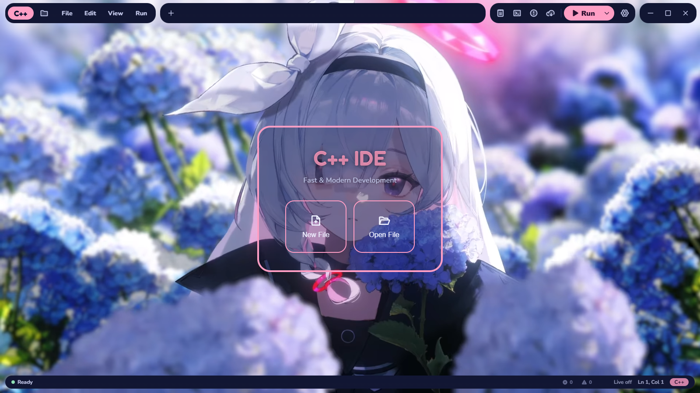
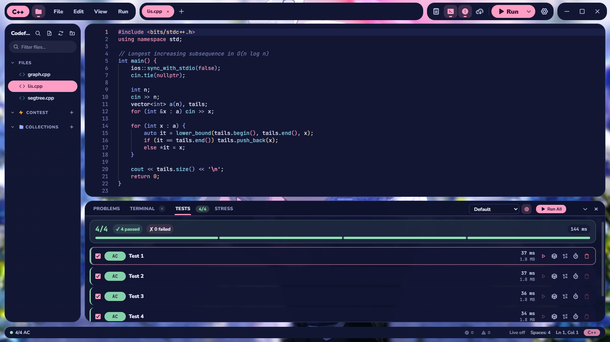
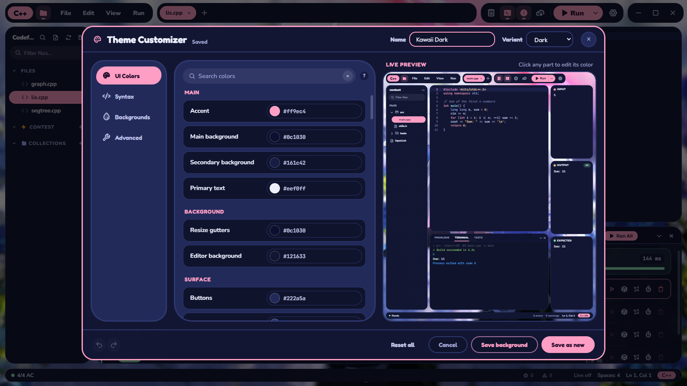
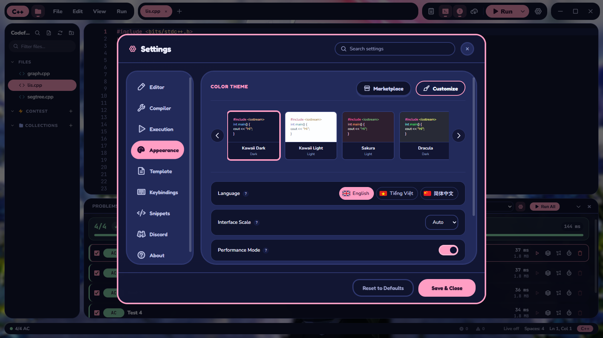

<div align="center">
  <br />
  
  <br />
  

  ### 🐟 Sameko Dev C++ ⚓

  **The cutest & fastest C++ IDE for your coding adventures! (≧◡≦) ♡**

  <p>
    <a href="https://sameko.dev/" target="_blank" rel="noopener noreferrer">
      
    </a>
    <a href="https://github.com/QuangquyNguyenvo/Sameko-Dev-CPP/blob/main/LICENSE">
      
    </a>
    <a href="https://github.com/QuangquyNguyenvo/Sameko-Dev-CPP">
      
    </a>
  </p>
</div>

<br />

<div align="center">
  ★ 。＼｜／。★
  <br/>
  <b>Welcome to the deep blue sea of coding! 🌊</b>
  <br/>
  ★ 。／｜＼。★
</div>

<br />

<div align="center">
  
</div>

<br />

<div align="center">
  <p>
    <a href="#features">Features</a> •
    <a href="#screenshots">Screenshots</a> •
    <a href="#development">Development</a> •
    <a href="#shortcuts">Shortcuts</a>
  </p>
</div>

<br />

<div align="center">

### About Sameko Dev C++

</div>



**Code::Blocks and Dev-C++ feel too old? VS Code takes too much setup?**

 **Sameko Dev C++** is an anime-styled, open-source IDE for C++ and competitive programming, with support for 7+ other languages. Open a file, press `F11`, and your code runs.

 The Windows version comes with GCC 16, clangd and GDB built in, so there's nothing to set up. Sameko also runs on Linux and macOS (beta).

> [!NOTE]
> Unofficial fan project, not affiliated with Sameko Saba. [Why the name?](#the-story-behind-it)

<br clear="right" />

<div align="center">

### Features

</div>



#### Build and run

&nbsp;&nbsp;**GCC 16 bundled** on Windows, system `g++` on Linux<br />
&nbsp;&nbsp;**One-key run** with `F11`, skipping unchanged builds<br />
&nbsp;&nbsp;**Multi-file** projects with your own headers<br />
&nbsp;&nbsp;**IntelliSense** by clangd with live diagnostics<br />
&nbsp;&nbsp;**Compiler settings** for C++ standards and flags<br />
&nbsp;&nbsp;**9 languages**, from C++ to Python, Java and Rust<br clear="all" />



#### Practice and debug

&nbsp;&nbsp;**Judge verdicts** for AC, WA, TLE and memory limits<br />
&nbsp;&nbsp;**Stress tests** with checkers and interactors<br />
&nbsp;&nbsp;**Fetch problems** with Competitive Companion<br />
&nbsp;&nbsp;**Submit to judges** like Codeforces, AtCoder and CSES<br />
&nbsp;&nbsp;**Contests** with statuses, notes and saved approaches<br />
&nbsp;&nbsp;**Visual debugger** with watches and STL variables<br clear="all" />



#### Edit and customize

&nbsp;&nbsp;**3 UI languages**: English, Tiếng Việt, 简体中文<br />
&nbsp;&nbsp;**Tabs and split panes** you can drag and rename<br />
&nbsp;&nbsp;**Vim mode** with a cursor trail<br />
&nbsp;&nbsp;**Markdown preview** beside your code<br />
&nbsp;&nbsp;**Code format** with 13 AStyle styles<br />
&nbsp;&nbsp;**Snippets and templates** you can import<br />
&nbsp;&nbsp;**Auto-save and local history** to keep work safe<br />
&nbsp;&nbsp;**11 themes**, plus your own with image or video<br />
&nbsp;&nbsp;**Searchable settings** and custom keybindings<br clear="all" />

<details>
<summary><b>Read the full feature list</b></summary>

##### Build and run

- 🚀 **GCC 16 included** on Windows. On Linux, Sameko uses your system's `g++`.
- ⚡ **Build and run with `F11`.** Unchanged files run again without recompiling.
- 🔗 **Multi-file mode** links the matching `.cpp` for each custom header you include.
- 🧠 **Code completion and live diagnostics** from clangd, with your choice of C++ standard and compiler flags.
- 🧩 **Seven more languages:** run and test Python, Java, Kotlin, Rust, Go, Pascal and JavaScript with the compiler on your machine. Code completion and debugging are for C and C++.

##### Practice and debug

- ✅ **Judge-style results:** compare input, output and expected answers with AC, WA and TLE verdicts. `cerr` stays in its own Stderr card, and large inputs can load from a `.txt` file.
- 🏆 **Competitive Companion:** fetch problems and tests, then run them all in parallel or one at a time.
- 🗂️ **Contests and collections** keep your problems, statuses, notes and saved approaches together.
- 🐞 **Visual debugger** with breakpoints, conditions, watches and STL-aware variable trees. Auto dry run steps through your code as values change.

##### Edit and customize

- 🌏 **English, Tiếng Việt and 简体中文** interface. Code and program output are never translated.
- 📑 **Tabs and split panes:** rename tabs, drag files in, and create C++, C, input, output, text or Markdown files from the tab bar.
- ⌨️ **Vim Mode** (`:w`, `:q`, `:wq`), a cursor trail, scrolling past the last line and per-file indentation.
- 📝 **Live Markdown preview** beside the editor. Toggle it with `Ctrl+Shift+V`.
- 🧹 **AStyle formatting** for C and C++, with 13 styles and optional format on `Ctrl+S`.
- ✂️ **Snippets and templates:** write your own, import them from files, and edit or hide the built-ins.
- 💾 **Auto-save, session restore and local history** protect your work, and Sameko notices changes made outside the editor.
- 🎨 **Eleven built-in themes**, including Catppuccin Mocha, Gruvbox Dark, Crimson and Event Horizon. Build your own, add an image or video background, and share it.
- 🔎 **Searchable settings and shortcuts**, with customizable keybindings.

</details>

Explore the [user guide](https://sameko.dev/wiki) for more features and instructions.

<br />

<div align="center">

### Screenshots

</div>

<div align="center">
  
  <br /><br />
  
  
  <br />
  
  
</div>

<br />

<div align="center">

### What's New in v1.5.0

</div>

- **macOS beta.** Runs on Apple Silicon (M1 and later) with Homebrew GCC and LLDB.
- **Judge-style testing.** Memory limits, Large Stack, testlib checkers and stress tests that add the failing test for you.
- **Tools on each test.** Debug a test, re-run it with checks, draw its input as a graph, or profile it.
- **A stronger debugger.** Watchpoints and an array view that shows which elements changed.
- **Better navigation.** Go to Definition, Find All References, Quick Fix and Find in Files.
- **Seven more languages.** Python, Java, Kotlin, Rust, Go, Pascal and JavaScript, with the compiler on your machine.
- **Smaller updates.** About 20 MB instead of the whole installer.

See [CHANGELOG.md](CHANGELOG.md) for the full list and [the release notes](https://github.com/QuangquyNguyenvo/Sameko-Dev-CPP/releases/latest) for screenshots.

#### Multi-file project note

If your project is split across multiple `.cpp` files and you see linker errors like `undefined reference`, open:

- `Settings > Compiler > Single-file Compile Mode`

Then turn it **OFF** and build again.

<div align="center">

### Download

</div>

<p align="center">
  <a href="https://sameko.dev/" target="_blank" rel="noopener noreferrer"></a>
  <a href="https://github.com/QuangquyNguyenvo/Sameko-Dev-CPP/releases/latest" target="_blank" rel="noopener noreferrer"></a>
  <br />
  <sub>Only download Sameko from these two places.</sub>
</p>

<details open>
<summary><b>Windows</b>: GCC 16, clangd and GDB included</summary>

<br />

- **Installer (recommended):** `sameko-dev-cpp-setup-<version>.exe`. Adds shortcuts and auto-update.
- **Portable:** `sameko-dev-cpp-<version>-portable.zip`. Extract and run anywhere, even from a USB drive.

> [!TIP]
> **SmartScreen warning?** Sameko is not code-signed yet. Click **More info**, then **Run anyway**. See the 1.4.0 [VirusTotal scan](https://www.virustotal.com/gui/file/f184db56cee5cefdc4a9b4d90a4535780c977d0cfd4a33b7d43db80c5f8b1449) (0/56).

</details>

<a name="linux"></a>
<details>
<summary><b>Linux</b>: 64-bit AppImage, uses your system's tools</summary>

<br />

 **Install the compiler, debugger, code suggestions and formatter**

```bash
# Debian / Ubuntu / Linux Mint / Pop!_OS
sudo apt update && sudo apt install -y g++ gdb clangd astyle

# Fedora / RHEL
sudo dnf install -y gcc-c++ gdb clang-tools-extra astyle

# Arch Linux / Manjaro
sudo pacman -S --noconfirm gcc gdb clang astyle
```

 **Download** `sameko-dev-cpp-1.5.0-linux-x86_64.AppImage` from [Releases](https://github.com/QuangquyNguyenvo/Sameko-Dev-CPP/releases/latest) or [sameko.dev](https://sameko.dev/)

 **Run it** from your download folder

```bash
chmod +x sameko-dev-cpp-1.5.0-linux-x86_64.AppImage
./sameko-dev-cpp-1.5.0-linux-x86_64.AppImage
```

Need a `.deb` or `.tar.gz`? See [Building](#building).

<details>
<summary><b>Something not working?</b></summary>

<br />

- **The AppImage does not open.** Ubuntu 22.04+ may need FUSE 2:
  ```bash
  sudo apt install libfuse2
  ```
  Or run it with `./sameko-dev-cpp-*.AppImage --appimage-extract-and-run`.

- **It closes with a sandbox error** (`The SUID sandbox helper binary was found, but is not configured correctly`). Ubuntu 24.04+ can block the sandbox for apps that are not installed. Use a `.deb` built from source, or run:
  ```bash
  ./sameko-dev-cpp-*.AppImage --no-sandbox
  ```

- **Chrome Sandbox error from a `.tar.gz`** on Ubuntu 24.04+:
  ```bash
  sudo chown root:root chrome-sandbox && sudo chmod 4755 chrome-sandbox
  ```

- **No IntelliSense, or Format Code does nothing.** Install `clangd` and `astyle`, then restart Sameko.

</details>

</details>

<details>
<summary><b>macOS (beta)</b>: Apple Silicon, M1 and later</summary>

<br />

 **Install GCC and AStyle** (LLDB comes with Apple's Command Line Tools)

```bash
xcode-select --install
brew install gcc astyle
```

 **Download** `mac-arm64.dmg` from [Releases](https://github.com/QuangquyNguyenvo/Sameko-Dev-CPP/releases/latest) and drag Sameko into Applications

 **Allow the first launch**, because the app is not signed by Apple

```bash
xattr -cr "/Applications/Sameko Dev C++.app"
```

> [!NOTE]
> macOS does not auto-update. Sameko shows a download button when a new version is out.

</details>

<br />

<div align="center">

### Development

</div>

You need [Node.js](https://nodejs.org/) 22.12+ and npm. On Linux or macOS, also install the compiler tools from [Download](#download).

```bash
git clone https://github.com/QuangquyNguyenvo/Sameko-Dev-CPP.git
cd Sameko-Dev-CPP
npm install
npm start
```

#### Building

| Command | Builds |
| :--- | :--- |
| `npm run build` | Windows installer, portable `.zip` and Linux AppImage |
| `npm run build:win` | Windows only |
| `npm run build:linux` | AppImage, `.deb` and `.tar.gz` (on Linux or WSL) |
| `npm run build:mac` | macOS `.dmg` and `.zip` |
| `npm run build:all` | Windows and all Linux packages |

Finished files go to `samekodevcpp/`.

<details>
<summary><b>Release files and build notes</b></summary>

<br />

| File | What it is |
| :--- | :--- |
| `sameko-dev-cpp-setup-<version>.exe` | Windows installer people download |
| `sameko-dev-cpp-update-<version>.exe` + `.blockmap` | Copy used by the in-app updater. Upload it with every release |
| `sameko-dev-cpp-<version>-portable.zip` | Windows portable build |
| `sameko-dev-cpp-<version>-linux-x86_64.AppImage` | Linux build for any distribution |
| `latest.yml` | Update info the app reads |

- **AppImage on Windows** needs symlink permission. `npm run build` switches to WSL by itself when that permission is missing.
- **`.deb` packages** need `fpm`, which has no Windows build. Run `npm run build:linux` in WSL or on Linux.

</details>

<details>
<summary><b>Test and cleanup commands</b></summary>

<br />

```bash
npm test             # run every test suite
npm run clean        # delete your local settings, history and snippets
npm run clean:dist   # delete samekodevcpp/
npm run rebuild      # clean:dist, then a full build
```

</details>

<br />

<div align="center">

### Shortcuts

</div>

| Key                | Action               |
| :----------------- | :------------------- |
| `F9`               | Compile              |
| `F10`              | Run                  |
| `F11`              | Compile & Run        |
| `Ctrl + N`         | New file             |
| `Ctrl + O`         | Open file            |
| `Ctrl + S`         | Save file            |
| `Ctrl + Shift + S` | Save As              |
| `Ctrl + J`         | Toggle Panel         |
| `Ctrl + \`         | Split Editor         |
| `Ctrl + Shift + A` | Auto Format (AStyle) |
| `Ctrl + Shift + V` | Toggle Markdown preview |
| `Ctrl + Alt + S`   | Toggle Auto-Save     |
| `Ctrl + Shift + P` | Command Palette      |

#### While debugging

Click the left gutter to set a breakpoint, then press `F5`. `F10` and `F11` switch to stepping for
as long as the session is live, and go back to Run / Compile & Run once it ends.

| Key               | Action                                        |
| :---------------- | :-------------------------------------------- |
| `F5`              | Start debugging · Continue                    |
| `F10`             | Step over                                     |
| `F11`             | Step into                                     |
| `Shift + F11`     | Step out                                      |
| `Shift + F5`      | Stop debugging                                |
| `Esc`             | Stop an Auto dry run · leave the step history |
| `Alt` + gutter    | Conditional breakpoint                        |
| `Ctrl` + gutter   | Enable / disable a breakpoint                 |
| Right-click a line | Run to Cursor                                |

<br />

<div align="center">

### Contributing

</div>

**💖 Contributors**

- **[Yunchan](https://yunchancomms.carrd.co/)** (Special thanks for designing the logo!)
- **[Nuu (@XD_zow)](https://x.com/XD_zow)** (Drew the Saba illustration on the website)
- **[KingShiba3766](https://github.com/daonghiemminh-collab)** (Donated the `sameko.dev` domain)
- **[aiko-chan-ai](https://github.com/aiko-chan-ai)** (Fixed G++ spawn issue on some machines)
- **[aguajardoc](https://github.com/aguajardoc)** (Added template and snippet imports and fixed the Linux dock icon)
- **[baodao211](https://github.com/baodao211)** (Contributed the cursor trail and Scroll Beyond Last Line)
- **[MerlyStella](https://github.com/MerlyStella)** (Tested everything, twice. The app is better because of it :D)
- **[JuggyBob](https://github.com/JuggyBob)** (Found and reported a lot of bugs)

**📝 Want to contribute?**

Contributions are welcome! Please read [CONTRIBUTING.md](CONTRIBUTING.md) before submitting a PR.

<br />

<div align="center">

### The story behind it

</div>

Sameko Dev C++ started because I wanted a nicer place to practice CP. Dev-C++ felt too old and barely let me customize anything, while VS Code made me set everything up again every time I switched computers at school, so I started building my own. The problem was I had no idea what it should look like. I always had Saba's covers (and the graduated shork vtuber's, iykyk :P) playing while I worked. Then one of her songs came on and I thought, hey, why not build it around her? She's cute and one of a kind, exactly what I wanted for my own little waifu IDE, and that's how it became Sameko Dev C++.

**Not an official project.** Sameko Dev C++ is a free, unofficial fan project. It is not affiliated with or endorsed by Sameko Saba or anyone who represents her. All rights to her name, likeness and artwork belong to their owners. Saba's character design is by Shouu and her illustration by Tousaki Shiina. The built-in themes don't use her artwork; I'd love to make a Saba theme one day, but only with permission.

**Saba, if you ever see this:** hi! I wanted to ask your permission, but I couldn't find a way to message you. If you'd rather I change the name or anything else, please email me at [nguyenvoquangquy.it@gmail.com](mailto:nguyenvoquangquy.it@gmail.com) and I'll do it right away.

If you own any of the artwork above and want something changed or removed, email me or [open an issue](https://github.com/QuangquyNguyenvo/Sameko-Dev-CPP/issues) and I'll fix it quickly.

<br />

<div align="center">

### License

</div>

The source code of Sameko Dev C++ is licensed under the **MIT License**, see [LICENSE](LICENSE). Bundled tools keep their own licenses, such as GCC and GDB (GPL) and clangd (Apache 2.0). Saba's name and artwork are not covered by this license and belong to their owners.

<br />

---

<div align="center">
  <p>Made with 💙 and 🐟 by <a href="https://github.com/QuangquyNguyenvo"><strong>QuangquyNguyenvo</strong></a></p>
  <p><i>"Have a bubbly day!"</i></p>
  <br />
  <p>
    <a href="https://github.com/QuangquyNguyenvo/Sameko-Dev-CPP/issues">Report Bug</a> •
    <a href="https://github.com/QuangquyNguyenvo/Sameko-Dev-CPP/issues">Request Feature</a>
  </p>
</div>


